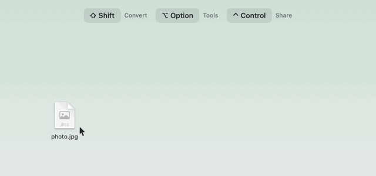

<p align="center">
  <picture>
    <source media="(prefers-color-scheme: dark)" srcset="brand/symbol/rondelle-symbol-dark-bg.svg">
    
  </picture>
</p>

# Rondelle

*File tools, thoughtfully arranged.*

A menu bar utility for macOS that turns a file drag into a conversion. While dragging from Finder, press **⇧ Shift**
to bring up the wheel with the formats for that kind of file, then release on one. The new file lands in the same folder.

Conversions run locally and nothing is uploaded: the part of the app that reads your files has no network access. The only
connections are a once-a-day [update check](#updates), which you can turn off, and the contact form in Settings, only when
you press Send. Translation uses Apple's service, which according to Apple works on the device.
Available in **Italian, English and French**
(it follows macOS, or choose it in Settings → Behaviour).

<p align="center">
  <picture>
    <source media="(prefers-color-scheme: dark)" srcset="docs/tutorial-dark.gif">
    
  </picture>
  <br><sub>From the interactive tutorial that opens at the first launch: there you drag the sample photo yourself.</sub>
</p>

## Install

**[⬇ Download the latest version](https://github.com/jackb998/rondelle/releases/latest)**, then under *Assets*
click **`Rondelle-<version>.dmg`**. That is the only file you need: the two *Source code* archives are added by
GitHub automatically and are not used to install. macOS 13 or later, Apple silicon and Intel Macs.

The disk image window shows the same three steps:

1. **Drag Rondelle onto Applications** (both are in the window that opens with the disk image).
2. **Open Terminal:** double-click **Open Terminal** in the disk image window, or press **⌘ Space** and type *Terminal*.
3. **Drag *Allow Opening* from the disk image window into the Terminal window and press Return.** Rondelle opens
   and its ring icon appears in the menu bar. This is needed only once; afterwards Rondelle opens like any app.

Why step 3: Rondelle is free and not notarized by Apple (that needs a paid developer account), so macOS 15 and later
block its first opening. *Allow Opening* is a short script, readable in the repository at
[`distribution/dmg/Allow Opening`](distribution/dmg/Allow%20Opening): it removes the download mark (quarantine) from
`/Applications/Rondelle.app` only and opens it. No password, no other change, nothing sent anywhere.

**Without Terminal:** open Rondelle from Applications, click **Done** (not *Move to Trash*), then open **System
Settings → Privacy & Security**, scroll to *"Rondelle" was blocked…* and click **Open Anyway**. On macOS 13 and 14
you can instead right-click Rondelle, choose **Open**, then **Open** again.

**Check the download (optional):** each release lists the SHA-256 of its disk image. In Terminal,
`shasum -a 256 ~/Downloads/Rondelle-<version>.dmg` must print the same string.

**Update:** when the menu shows a new version, download it, quit Rondelle (menu bar icon → *Quit*) and drag the new
app onto Applications, replacing the old one. Your settings stay.

**Uninstall:** quit Rondelle and move it from Applications to the Trash.

## How it works

| Gesture | Wheel |
|---|---|
| ⇧ Shift + drag | **Convert**: output formats for that kind of file |
| ⌥ Option + ⇧ Shift + drag | **Tools**: compress, resize, merge, split, … |
| ⌃ Control + ⇧ Shift + drag | **Share**: AirDrop, Messages, Mail (your default mail app), Telegram, WhatsApp, Terminal, any app you add |
| Drop in the centre | Cancel |
| Finder → right-click → Services → *Rondelle: Converti… / Strumenti…* | The same wheels, used with **clicks** instead of a drop (Esc or a click in the centre cancels) |
| Finder → right-click → Services → *Rondelle: Comprimi* | Compresses the selection directly |
| Select files in the Finder, then **⌘⇧V** (Convert), **⌘⇧M** (Tools) or **⌘⇧X** (Share) | The same wheels from the keyboard: ← → to choose, ↓ ↑ for variants, Return to confirm, Tab to switch wheel, Esc to close. Shortcuts can be changed in System Settings → Keyboard → Keyboard Shortcuts → Services |
| Shortcuts → *Converti con Rondelle* | Any wheel action (except the ones that open a window) inside a shortcut |

The Tools wheel groups similar actions (Compress, Resize, Edit, Pages, Protection, Speed, ZIP…). Moving over a
group fans its variants out on a **second ring**; dropping on the group opens a small **options panel** next to the
file. Settings → Wheel → *Style*: ring and panel (default), ring only, panel only, or the full wheel without groups.

Each wheel's keys can be changed in Settings → Behaviour (one or two of ⌃ ⌥ ⇧ ⌘). Near a screen edge the wheel
moves inwards so it is never cut; moving over an item gives a light trackpad tap and a soft click (both adjustable).

On macOS 26 and later the wheel is made of **Liquid Glass**. The menu bar menu has **Undo last conversion**
(moves the files it created to the Trash) and **Recent** (the last 10 jobs, click to reveal them in Finder).

Labels that don't fit their segment are shrunk or shortened with "…"; hovering a segment shows its full name on a
highlighted pill and in the centre of the wheel.

A multiple selection works too: release it on one action and every file is processed. Progress appears in a small
window, then Finder opens on the results.

## What it can do

| File type | Convert (⇧) | Tools (⌥⇧) |
|---|---|---|
| Images (JPG, PNG, HEIC, TIFF, GIF, BMP, WebP, AVIF, SVG…) and **camera RAW** (DNG, CR2, CR3, NEF, ARW, RAF, ORF, RW2…; tools save RAW as JPG) | JPG, PNG, HEIC, **WebP**, TIFF, GIF, BMP, PDF, **PPTX** (one slide per image), **ICNS, ICO** | Compress, target file size, 50%, custom pixel sizes, **rotate** (90° right or left, 180°, mirror horizontally or vertically), remove background, **text (OCR)**, **copy text** to the clipboard, read QR codes, read or strip metadata, **Edit** (adjust light/colour/detail, crop, draw, arrows, text, cover), **Layout** (2+ photos), PDF, ZIP, protected ZIP |
| PDF | PNG, JPG (one per page), TXT (OCR when the PDF is a scan), DOCX, RTF, **PPTX** (one slide per page) | Compress, strong compress, target file size, **Merge** (2+ PDFs) / **Organize** (1 PDF), split, **OCR** (searchable PDF), read or strip metadata, **password** / **unlock**, page numbers, watermark, **rotate**, **redact** (really removes what it covers), **translate**, ZIP |
| PDFs and images together | PDF (merge window) | Merge, ZIP |
| Video (MP4, MOV, M4V…) | MP4, MOV, M4V, GIF, M4A | **Trim**, 1080p, 720p, **target file size**, HEVC, 2× / 0.5× speed, join, snapshot, mute, audio only, read or strip metadata, **subtitles from speech** (macOS 26+), ZIP |
| Audio (M4A, WAV, AIFF, FLAC, MP3…) | M4A, WAV, AIFF, FLAC, **MP3** | **Trim**, normalize, mono, compress, read or strip metadata, **subtitles from speech** (macOS 26+), ZIP |
| Documents (DOCX, DOC, RTF, ODT, HTML, TXT, MD) | PDF, DOCX, RTF, ODT, HTML, TXT | **Translate**, read metadata (and strip author, company and dates from DOCX), ZIP |
| **Spreadsheets** (XLSX, ODS, CSV, TSV) | XLSX, ODS, CSV, TSV, HTML, PDF | Read metadata (and strip author, company and dates from XLSX), ZIP |
| **Presentations** (PPTX) | PDF, PNG, JPG (one per slide), TXT (slides and speaker notes) | Read metadata (and strip author, company and dates from PPTX), ZIP |
| Subtitles (SRT, VTT) | SRT, VTT, TXT | **Translate**, read metadata, ZIP |
| Archives (ZIP, TAR, GZ, TGZ, BZ2, XZ, RAR, 7Z) | Extract | Extract (**Unlock and extract** for password-protected ZIPs: the password is asked once), read metadata, protected ZIP |
| Folders and other files | ZIP, TAR.GZ | Read metadata, ZIP |

Built on Apple frameworks (ImageIO, PDFKit, AVFoundation, Vision, AppKit, SwiftUI) plus two open-source encoders
compiled into the app: **libwebp 1.6.0** (BSD) for WebP and **LAME 4.0** (LGPL) for MP3. Only their encoders are
included, they only receive pixels and samples macOS has already decoded, and they never touch files or the network.
Origin, checksums and update steps: `Sources/CWebP/PROVENANCE.md`, `Sources/CLame/PROVENANCE.md`.

**Protected ZIP** uses AES-256 (system bsdtar; the password goes through a pipe, never on the command line) and
hides the file names inside; passwords under 12 characters ask for confirmation, and under 8 characters a warning says the ZIP is weakly protected, with a *More* disclosure that explains why (brute force). It opens with Keka, The Unarchiver or
7-Zip (also on Windows), not with the Finder or Archive Utility. ZIP and TAR.GZ leave out extended attributes (download
origin, quarantine, tags) and the name of the source folder. Spreadsheets keep values only (formulas give their last result, no styles or charts);
old XLS files aren't supported. **Open in Pages / Open in Numbers** (DOCX, DOC, RTF, TXT, .pages; XLSX, CSV, TSV, .numbers) opens the file in Apple's app through macOS, where you save or export it: their formats are Apple's own, so Rondelle doesn't write them, and it needs no permission to control other apps.

**PowerPoint (PPTX)** is read by Rondelle itself (the ZIP's index and parts are read in memory, with a size cap on
each part, and the system's XML parser) and drawn with Core Graphics: slide size, background, title and body text
(size, bold, italic, colour, bullets and spacing, also when they come from the layout and the master), shapes with a
fill, free-form panels, arrows, pictures (with cropping and rotation), tables and grouped objects. Position, shape and
margins of a placeholder come from its layout and master, as in PowerPoint. Hidden shapes and hidden slides are left out,
as in the PDF PowerPoint makes. Text stays text in the PDF, so it can be selected and searched. Left out: charts,
SmartArt, animations and transitions, video and audio, shadows and gradients, table styles, EMF/WMF/SVG pictures (a
logo in that format is missing); fonts that aren't installed (including fonts embedded in the file) are replaced, so
the line breaks, and slides with complex layouts, will not match PowerPoint's exactly. **PDF → PPTX** and **images →
PPTX** write one slide per page or image, with the page as a picture (it looks like the original, but is not editable
text); the text of a PDF page goes in the picture's alternative text, and several images become one deck. PPTX files
are limited to 50 MB, 1000 slides (a confirmation above 300) and the same limit on unpacked XML as Word files; old PPT
files aren't supported.
**Translate** (macOS 15 or later) makes a copy in Italian, English or French with Apple's Translation framework, which according to Apple works on the device: Rondelle still has no network access (a missing language is downloaded by macOS itself, after asking). The source language is recognized by itself; if there is too little text you are asked, and languages other than these three are refused. The format stays the same (DOC becomes DOCX; RTFD becomes RTF; web archives become HTML), subtitles keep their times, Markdown its marks and code blocks. Inside a paragraph, inline styles give way to the paragraph's main style. A **PDF comes back as plain text pages**, without its layout or images (scans go through OCR). Up to 2 million characters, about 3 KB per second on an Apple silicon Mac.

**Hidden text in PDFs:** translation and conversion to text read hidden, white or covered text, and it appears in the result. To really black something out, turn the page into an image and use *Cover* in *Edit*.

**Password hints**: Protected ZIP and PDF password can carry an optional hint (100 characters at most), shown when the password is asked. It is stored **in clear** next to the encrypted data, so anyone with the file can read or change it; a hint containing the password is refused. In a ZIP it is the archive comment (other apps show it too), in a PDF a comment after the end of the file (only Rondelle reads it, and re-saving elsewhere drops it).

**Known limits:** no MKV/AVI/WMV *input* (not supported natively by macOS). PDF passwords use PDFKit's
128-bit RC4, like Preview: weak protection, so for confidential data use Protected ZIP. Page numbers and watermark drop links and bookmarks.
Remove background needs macOS 14.

## Layout and Merge windows

**Layout** (⌥⇧ + drag 2–9 photos → *Layout*) works like Instagram's Layout app:

- every arrangement for that number of photos is shown with your own photos: grids, rows, columns, one big + the rest;
- formats 1:1, 4:5 (Instagram post), 9:16 (story), 16:9 and 3:2;
- border thickness and colour, rounded corners;
- click one photo, then another, to swap them, or shuffle them all;
- **smart crop**: Vision finds faces (or the most eye-catching subject) so crops keep them in frame;
- saved as `Layout.jpg` (2160 px on the long side).

**Merge / Organize** (⌥⇧ + drag PDFs, or PDFs and images → *Unisci*; one PDF → *Organizza*):

- thumbnails of every page; drag them to reorder;
- rotate or delete single pages, reverse the order, name the output file;
- images become pages, so photos and PDFs can be combined into one document.

**Text (OCR)** uses Apple's Vision on device (Italian, English, French, German, Spanish, Portuguese): on an image it
saves a `.txt` and copies the text to the clipboard; on a PDF it adds an invisible text layer so a scan becomes
searchable and selectable.

**Trim** opens the file with the system trimming bar (the same as QuickTime Player); confirm and the trimmed copy is
saved without re-encoding when the format allows it.

## Share wheel

⌃⇧ + drag. System services (AirDrop, Messages, Mail through your default mail app), apps with their own share
extension (Telegram: pick the chat right away), apps without one (WhatsApp, or WhatsApp Web when the app isn't
installed: the files go on the clipboard and you paste them with ⌘V), **Copy**, **Terminal** (a window in the
files' folder, with their quoted paths on the clipboard) and the full macOS share menu. More apps and macOS
services can be added in Settings → Wheel → Share.

With **Share without location and metadata** on (Settings → Privacy, on by default), photos, videos, audio and PDFs
leave as temporary copies without GPS, device, dates and author, under the original name; the originals don't
change. The app that reads your files has no network access.

## Shortcuts

The **Converti con Rondelle** action takes some files and an action name (*JPG*, *Comprimi*, *480px*, *OCR*, …;
the list offers every action that doesn't need a window) and returns the results, so it can be chained with other
actions or run from Finder's Quick Actions. The files are copied into the app's sandbox temporary folder and
processed there: nothing is written next to the originals, and results that are folders (PDF pages, extracted
archives) are returned as the files inside them. *Peso…* uses the default size from Settings. Temporary copies are
deleted on a later run, after an hour.

## Settings

Open them from the menu bar icon → **Impostazioni…** (⌘,). The window follows System Settings: a sidebar with
coloured icons and grouped panes.

The sidebar has a search field (it also finds the settings inside each pane). While Settings is open Rondelle
shows in the Dock and has a menu bar; otherwise it lives only in the menu bar.

- **Appearance:** wheel size (60–160%), **shape of the pieces** (sharp by default, rounded, extra soft, chamfered or pizza slice), Liquid Glass on/off and its tint (or background opacity without glass), wheel theme, accent colour, icons, opening animation, trackpad tap and click sound when moving over items (strength and volume), theme of the Settings window. Includes a live preview; while you drag the size slider (or with *Grandezza reale* on) a blank wheel at its real on-screen size appears beside the window.
- **Behaviour:** keys for each wheel, pause Rondelle, **language** (as macOS, Italian, English, French), reveal results in Finder, sound when done, **completion animation** (the ring opens where you dropped the file), launch at login.
- **Wheel:** for each kind of file and each wheel (Convert / Tools / Share), tick the actions to show and drag them into your order, with a live preview; add apps and macOS services to the Share wheel.
- **Conversions:** general options (resize presets, default *target file size*, where to save results) and a page for each output format: metadata, maximum size and quality for images; page resolution for PDF → images; quality and metadata for MP4/MOV/M4V; width and frame rate for GIFs; MP3 bitrate; 16/24-bit WAV and AIFF; CSV separator and UTF-8 mark for Excel.
- **Formats:** an interactive table of every conversion, per kind of file: hover a cell to highlight its row and column, click a source and a target (or a cell) to see green if Rondelle can convert, red if not.
- **Privacy:** what the app can and cannot access, sharing without location and metadata, **removing the location from converted photos and videos** (on by default: GPS, place names in IPTC/XMP and QuickTime location; dates, camera and author stay), the list of allowed folders with a one-click revoke, and the job history (file paths only, kept in the app's sandbox container): how many jobs to remember (5, 10, 15 or 20) and a clear button.
- **About:** version and credits.
- **Support Rondelle:** a *Buy me a coffee* link, opened in the browser (Rondelle itself still has no network access).
- **Help and contact:** the tutorial, and **Report a problem**, a short form sent only when you press Send; always last in the sidebar.

## Tutorial

An animated tutorial built on the real wheel opens by itself at the first launch and again from Settings → Help or the menu bar (*How to use…*). Its last page asks for the Home folder permission.

## Privacy and security

- **App Sandbox + Hardened Runtime**, like Mac App Store apps (`Resources/Rondelle.entitlements`).
  macOS itself blocks network access, camera, microphone, location, contacts and the Photos library.
- **Two exceptions to "no network"**, both separate sandboxed processes with outgoing connections and no access to your files:
  `UpdateCheck`, which only asks for the latest version (see [Updates](#updates)), and `FeedbackSend`, which sends the
  contact form in Settings → Help and contact when you press Send: your text, the email if you add one and, if you tick it, the app and
  macOS versions, to one fixed address (`api.formdall.de`, servers in Germany). Never files.
- Reads only the files you drop on the wheel and writes only to folders you explicitly allow. Permissions are
  stored as security-scoped bookmarks and can be revoked in Settings.
- **Privacy manifest** (`Resources/PrivacyInfo.xcprivacy`): no tracking. It declares only what the contact form sends
  when you press Send (your message and, if you add it, your email), used to answer you; nothing is collected automatically.
- Hardening against malicious files:
  - external tools (`zip`, `tar`, `ditto`) run by absolute path, without a shell;
  - file names are passed as `./name`, so they can never be read as command options;
  - archives are extracted with bsdtar, which refuses `..` paths and writing through symlinks;
  - archives and images that would expand to huge sizes ("decompression bombs") are refused;
  - XLSX/ODS: known entries are decompressed one at a time by `unzip -p` into the app's temporary folder and read
    from there a piece at a time (at most 600 MB per entry and 1.2 GB per file, counted on the real bytes; 6 million
    cells, 300 million characters, 1 million per cell); XML with a DTD is refused and external entities are off;
  - user-entered numbers are bounds-checked.

## Updates

Once a day, a separate process (`Sources/UpdateCheck`) asks `api.github.com` for the number of the latest release.
It sends no files or personal data, but GitHub sees your IP address. The address is fixed in that process, and the app
can't pass it anything, so it can't be used to send data out. Turn it off in Settings → Privacy, or use
**Check for Updates…** in the menu bar menu whenever you like.

A newer version adds an item to the menu and a dot to the icon. Updates don't install themselves: the app is ad-hoc signed,
so nothing could prove who built an update. You download it from the GitHub page, check it and replace the app.

## Opening the app the first time

Rondelle is ad-hoc signed, not notarized by Apple, so macOS 15 and later block its first opening. The disk image
carries *Allow Opening* for this (see [Install](#install)); *Open Anyway* in System Settings → Privacy & Security
works too. Each release lists the SHA-256 of its disk image to check the download:
`shasum -a 256 ~/Downloads/Rondelle-<version>.dmg`.

Found a security problem? See [SECURITY.md](SECURITY.md).

## Requirements

macOS 13 or later, on Apple silicon or Intel. Subtitles from speech need macOS 26, translation macOS 15.
Xcode 16 or later to build.

## Build from source

```bash
./build.sh            # builds build/Rondelle.app (ad-hoc signed)
./build.sh --install  # also copies it to /Applications and launches it
```

`build.sh` also generates the Shortcuts metadata (`Contents/Resources/Metadata.appintents`), which a plain
`swift build` doesn't: the compiler writes the intents' constant values and Xcode's `appintentsmetadataprocessor`
turns them into the metadata bundle.

The app icon is drawn in code: `swift tools/make_icon.swift` regenerates `Resources/AppIcon.icns`.

**A build to share:** `./release.sh` makes `dist/Rondelle-<version>.dmg` with one app for Apple silicon and Intel
(universal, macOS 13+), the reading notes in `distribution/README.txt` and the licences (LAME's source, as the
LGPL asks). Nothing is installed. Without an Apple Developer ID the app is ad-hoc signed and not notarized: on
another Mac it has to be allowed once in System Settings → Privacy & Security → *Open Anyway*.

**Licences:** Rondelle is under the [MIT licence](LICENSE). LAME (LGPL 2) and libwebp (BSD) keep their own, in
`Sources/CLame` and `Sources/CWebP`, with their origin in `PROVENANCE.md`.

**Tests of the update check:** `Tests/updates/run.sh` (needs the network, installs nothing).

## Testing without dragging

The command line exists only in a separate **test build** (compiled with `DEBUG`); the release app built by
`build.sh` contains none of it. Build the test binary and use it on test files:

```bash
swift build -c release --arch arm64 -Xswiftc -DDEBUG --scratch-path .build-test
M=.build-test/out/Products/Release/Rondelle
$M --list photo.heic                            # actions shown on the wheel
$M --run JPEG photo.heic                        # run a convert action
$M --run --tools 480px photo.heic               # run a tool
RONDELLE_VALUE=0.5 $M --run --tools "Peso…" photo.heic   # answer the action's question
$M --render wheel.png photo.heic                # picture of the wheel
$M --render-settings settings.png               # picture of the Settings window
$M --layouts out/ 4:5 a.jpg b.jpg c.jpg          # every layout template for these photos
$M --assemble out.pdf a.pdf#2@90 photo.jpg b.pdf#1   # merge pages (page number, rotation)
$M --trim clip.mov 1 3                           # keep seconds 1–3
$M --render-window settings out.png wheel        # picture of a Settings pane (or layout/merge windows)
```

**Security regression suite:** `Tests/security/run.sh [folder]` builds the test binary and recreates a corpus of
hostile files in a temporary folder: photos and videos with a location in every field, damaged and oversized
spreadsheets, stacked audio tags, files with extended attributes, photos with hidden thumbnails, depth maps or
data after the image. It then runs every attack of the security reports and prints a PASS/FAIL table; the exit
status is 1 if any check fails. It takes about 5–10 minutes and needs a few GB free; nothing it creates is committed.

**Functional tests:** `Tests/functional/run.sh [folder]` makes sample files (system pictures, synthetic video
and audio) and runs the 26 conversions of every kind of file; V1–V4 (links, decompression bombs) are
`Tests/security/v1v4.sh`, also run by the suite.

## Code map

| File | Role |
|---|---|
| `DragMonitor.swift` | Detects the modifier key during a drag (no Accessibility permission needed) |
| `Wheel.swift` | The wheel: drawing, theming, drop target, panel |
| `Actions.swift` | Which actions appear for each kind of file |
| `ImageOps` / `ImageTools` / `PDFOps` / `MediaOps` / `DocumentOps` / `ArchiveOps` | The actual conversions |
| `JobRunner.swift` | Progress window, folder permissions, Finder, errors |
| `LayoutRenderer.swift` / `LayoutView.swift` | Layout templates, smart crop, rendering and the Layout window |
| `MergeView.swift` | The Merge / Organize window for PDFs and images |
| `Settings.swift` / `SettingsView.swift` | Preferences and the Settings window |
| `Effects.swift` | Real-size wheel preview and the completion animation |
| `TextRecognition.swift` | OCR: text from images, searchable PDFs |
| `TrimWindow.swift` | Trim window for video and audio |
| `JobHistory.swift` | Recent jobs and *Undo last conversion* |
| `WheelConfig.swift` | Which actions each wheel shows, and their order |
| `FinderServices.swift` | Finder right-click services and the click-to-use wheel |
| `FolderAccess.swift` | Sandbox folder permissions (security-scoped bookmarks) |
| `ShortcutsIntent.swift` | The *Converti con Rondelle* Shortcuts action (App Intents) |
| `PhotoEditor.swift` | Edit window: crop, draw, arrows, text, cover (burnt into the pixels, no metadata) |
| `PDFTools.swift` | PDF password, unlock, page numbers, watermark |
| `Encoders.swift` | WebP and MP3 output through the bundled libwebp and LAME |
| `PhotoAdjust.swift` | Edit → Adjust: light, colour and detail with Core Image |
| `ShareOps.swift` | The Share wheel, copies without metadata, apps and services added in Settings |
| `PptxReader.swift` / `PptxRenderer.swift` / `PptxOps.swift` / `PptxWriter.swift` | PowerPoint: reading PPTX, drawing slides (PDF, PNG, JPG), text, and writing PPTX from PDFs and images |
| `SheetOps.swift` | Spreadsheets: safe XLSX/ODS/CSV/TSV reading and XLSX/ODS/CSV/TSV/HTML/PDF writing |
| `FormatSettings.swift` | Per-format conversion options |
| `FormatsView.swift` | Settings → Formats, the interactive conversion table |
| `WheelGroups.swift` / `OptionsPanel.swift` | Groups of similar tools, wheel styles and the options panel |
| `MetadataWindow.swift` / `OfficeMetadata.swift` | *Metadata → Read* window (any file, with a ⌘F search field) and the DOCX/XLSX/PPTX properties it reads and strips |
| `CLI.swift` | Command-line mode for testing |

The interface is in Italian, English and French (`Resources/<language>.lproj`; Italian text is the key).
